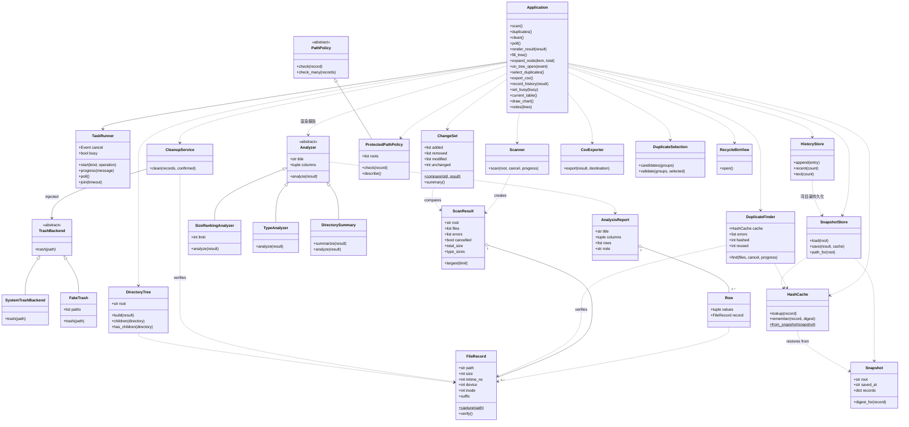

# 面向对象设计说明

版本 0.2.0。本文说明分层、类职责、协作流程与设计取舍，对应实现见 `diskcleaner/`，测试见 `tests/`。

## 一、分层与职责

| 层次 | 模块 | 职责 |
|---|---|---|
| 表示层 | `gui.py` | 布局、事件绑定、结果渲染；不计算统计、不直接删文件 |
| 任务调度 | `tasks.py` | 后台线程、事件队列、取消事件、busy 状态 |
| 领域服务 | `core.py`、`reports.py`、`policy.py` | 扫描、查重、清理、导出、重复副本策略、受保护路径 |
| 分析层 | `analyzers.py` | 统一的分析器契约与目录树聚合 |
| 状态与持久化 | `history.py` | 快照、增量对比、哈希缓存、历史摘要 |
| 系统适配 | `shell.py`、`diagnostics.py` | 回收站入口、依赖自检 |

表示层依赖领域对象，领域对象不导入 tkinter；`core`、`analyzers`、`policy`、`history`、`tasks` 都可以在无界面情况下测试。

## 二、类图

`FakeTrash` 只定义在测试模块中，用于替换真实回收站。

## 三、关键类说明

- **FileRecord**：不可变的文件快照（路径、大小、修改时间、设备号、文件标识）。`verify()` 重新采集并比较，是清理与查重的安全闸门；`suffix` 供类型统计复用，避免界面重复解析路径。
- **ScanResult**：一次扫描的结果容器；`total_size`、`type_sizes` 用 `cached_property` 缓存，避免界面多次渲染时反复对全量文件求和。
- **Scanner**：显式目录栈遍历，跳过链接/重解析点，权限异常记录后继续；进度按文件数或 0.2 秒节流。
- **DuplicateFinder**：先按大小分组，仅同大小候选才读内容；1 MiB 分块 SHA-256；读取前后各校验一次快照；同一 `(device, inode)` 只保留一份，避免把硬链接当可释放空间。可注入 `HashCache`，大小与修改时间未变时直接复用上次哈希。
- **CleanupService**：确认参数、审计日志先行（先写“准备”并 fsync，再执行，再写结果）、逐文件隔离失败；回收站后端由构造函数注入，因此测试可以完全不碰真实回收站。
- **TrashBackend / SystemTrashBackend**：抽象契约只有 `trash(path)`，生产实现调用 Send2Trash，没有永久删除回退。
- **Analyzer 族**：`analyze(result) -> AnalysisReport` 统一输出；界面只做“插入行”，新增统计维度不改界面。
- **DirectoryTree**：一次遍历把大小沿路径向上累加到各级目录，`children(path)` 供界面按需展开，避免一次性插入海量条目。
- **TaskRunner**：线程 + `queue.Queue` + `threading.Event`，把成功、失败、进度三类事件交回主线程；不导入 tkinter，可独立测试。
- **ProtectedPathPolicy**：拒绝清理 Windows、Program Files、ProgramData、系统盘根目录下的文件；批量检查时汇总全部被拒路径。
- **SnapshotStore / ChangeSet / HashCache**：快照是“上次扫描看到的样子”，用于增量对比与哈希复用；快照写入采用临时文件 + `os.replace`，避免半截文件。
- **HistoryStore**：结构化 JSONL，读取时跳过损坏行，保留旧格式兼容。
- **CsvExporter / DuplicateSelection**：只读导出与“每组留一份”的策略对象，均与界面解耦。
- **RecycleBinView**：通过系统外壳打开回收站，opener 可注入，测试用假实现。

## 四、设计原则落地

- **单一职责**：扫描不做统计，统计不做渲染，渲染不做清理，清理不做回收站调用。`Application` 只负责布局、事件与渲染，线程调度在 `TaskRunner`。
- **开闭原则**：新增统计维度 → 新增 `Analyzer` 子类；新增回收站实现 → 新增 `TrashBackend` 子类；界面无需改动。
- **里氏替换**：`FakeTrash` 与 `SystemTrashBackend` 对 `CleanupService` 完全等价，测试验证的是同一契约。
- **依赖倒置**：`CleanupService` 依赖抽象 `TrashBackend`，而不是 Send2Trash；`Application` 依赖 `Analyzer` 接口，而不是具体报表。
- **组合优于继承**：界面不继承扫描器/查重器，而是组合多个服务对象；继承只用于“同一契约的多种实现”。

## 五、关键流程

**扫描**：`Application.scan()` → `TaskRunner.start('scan', work)` → 后台 `Scanner.scan()`（进度事件入队）→ 主线程 `poll()` 取到 `done` → `render_result()` 依次渲染排行、类型、目录树、条形图 → `record_history()` 写历史。

**查重**：`duplicates()` → 后台 `DuplicateFinder(cache).find()`（进度、错误）→ 主线程展示分组 → 用户点“选择重复副本”只得到建议选择 → 清理前 `DuplicateSelection.validate()` 拒绝整组副本。

**清理**：当前页选中行 → `ProtectedPathPolicy.check_many()` → `DuplicateSelection.validate()` → 默认“否”的确认框 → 后台 `CleanupService.clean(confirmed=True)`：逐文件写审计意图 → 校验快照 → `SystemTrashBackend.trash()` → 写结果；完成后清空旧结果，要求重新扫描。

## 六、增量对比与哈希复用

1. 每次扫描完成后，把 `{路径: (大小, 修改时间, 内容哈希或空)}` 写入该根目录的快照（`snapshots/<路径哈希>.json`）。
2. 下次扫描同一根目录时，`ChangeSet.compare(old, result)` 给出新增、修改、消失、未变四类数量，显示在状态栏与历史中。
3. `HashCache.from_snapshot(old)` 只恢复“大小与修改时间都未变”的哈希；查重时这些文件不再读盘，`reused/hashed` 计数在状态栏可见。
4. 这不是“跳过目录遍历”的文件系统级增量扫描：目录仍要枚举，文件仍要 `stat`，省掉的是内容读取。

## 七、复杂度

- 扫描 N 个文件：O(N) 枚举，O(N) 内存保存清单；类型统计 O(N)。
- 大文件排行：全量排序 O(N log N)，非堆优化。
- 目录树构建：O(N × 目录深度)，`children()` 按需计算。
- 查重：O(N) 分组 + 候选文件字节数的读取成本；哈希复用可把重复查重的读盘量降到接近 0。
- 快照写入：O(N) JSON 序列化，在后台线程完成。

## 八、并发与状态

Tk 控件只在主线程访问；`TaskRunner` 用队列交付进度与结果，用 `Event` 取消扫描/查重。任务期间禁用按钮，避免并发操作旧结果；清理不提供中途取消，以保证逐项审计；任务进行中不允许直接关窗。清理完成或重新扫描都会使旧的文件映射失效，必须重新扫描才能再次清理。

## 九、安全模型

清理链路：手动选择 → 受保护路径 → 重复组保留 → 默认“否”的确认框 → 打开审计日志（失败即拒绝清理）→ 写“准备”并 fsync → 校验快照 → 调用回收站 → 写“结果”。日志中只有“准备”没有“结果”表示状态不确定，应人工检查回收站，不应自动重试。

失败隔离：单个文件失败只影响该文件，其余继续；任何异常都写进日志与结果表。权限不足时不提升进程权限。

已知限制：`stat` 校验与回收站调用之间存在 TOCTOU 竞争；元数据相同也不能证明内容未被恶意替换；网络盘/移动盘的回收站行为受系统限制；日志含完整路径，属于隐私数据。

## 十、答辩准备

1. 为什么先按大小分组再算哈希？——避免对不可能重复的文件读盘，把 SHA-256 的成本限制在同大小候选集内。
2. 为什么既有确认框又有 `confirmed` 参数？——界面交互与服务契约分别约束，服务层不信任调用方；这不是权限或认证机制。
3. 为什么测试不碰真实回收站？——避免破坏数据、可稳定模拟失败，并验证“日志先行、失败隔离”。
4. 为什么有 `TrashBackend` 抽象？——依赖倒置，生产实现与测试替身可互换；新增实现无需修改 `CleanupService`。
5. 为什么 `Analyzer` 是抽象类？——统一报告契约，新增统计维度只加子类，界面不改；这是开闭原则的直接体现。
6. 为什么把线程放 `TaskRunner`？——把“并发/取消/事件”与“界面布局”分开，两者可独立测试；`TaskRunner` 不依赖 tkinter。
7. 为什么 `total_size` 用缓存？——界面一次渲染会多次读取，百万文件时全量求和会明显卡顿。
8. 扫描总量为什么和资源管理器“占用空间”不同？——统计逻辑长度，不处理簇分配、压缩、稀疏与硬链接占用。
9. 增量扫描省了什么、没省什么？——省内容读取（哈希复用），不省目录枚举与 `stat`。
10. 如何把排行榜从 100 改成 50？——修改 `Application` 中 `SizeRankingAnalyzer(limit=50)`，或改常量。
11. 如何新增“按修改时间分布”？——新增 `ModifiedTimeAnalyzer(Analyzer)` 并加进界面的分析器列表，其余不变。
12. 如何验证取消？——扫描/查重过程中点“取消任务”，观察部分结果与“取消结果不允许清理”。
13. 为什么清理不能中途取消？——逐项审计与结果一致性优先；中途停止会让日志与界面状态更难解释。
14. 受保护路径策略为什么独立成类？——安全规则可单独测试与扩展，不与界面弹窗耦合。
15. 快照与扫描历史的区别？——快照用于对比与复用哈希（每根目录一份）；历史是每次扫描的摘要流水。
